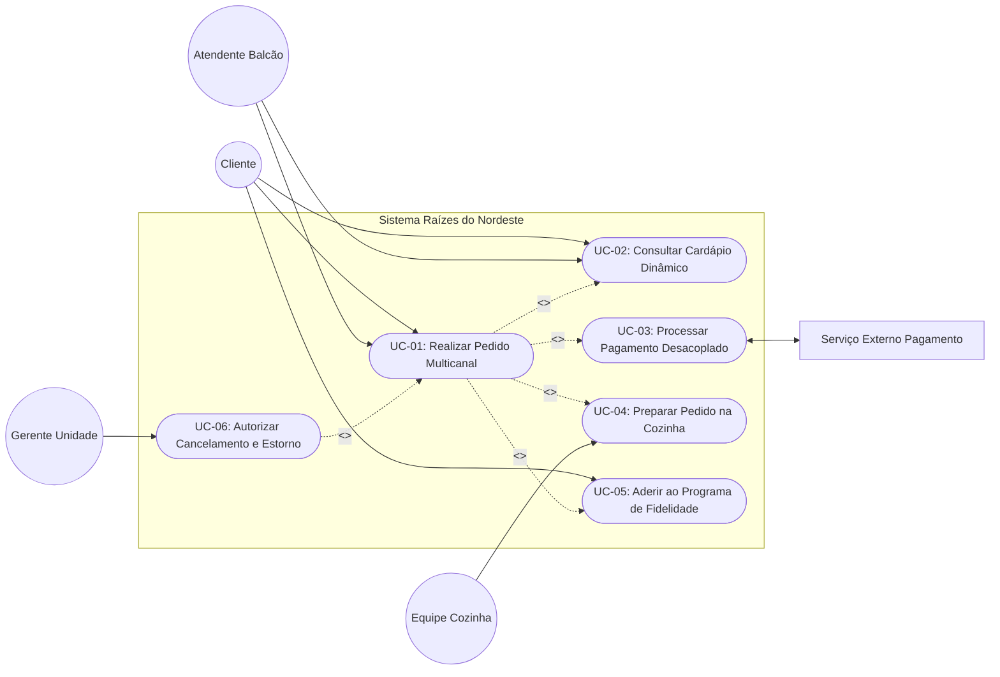

# Arquitetura da Solução e Casos de Uso - Rede Raízes do Nordeste

## 1. Visão Arquitetural e Separação de Responsabilidades

Para suportar a operação multicanal da rede Raízes do Nordeste e garantir alta testabilidade, manutenibilidade e tolerância a falhas, a solução é estruturada seguindo o padrão em camadas lógicas (Clean Architecture / Camadas de Responsabilidade):

```
+-------------------------------------------------------------------------+
|                        1. Camada de Apresentação                        |
|   [Aplicativo Mobile]   [Totem Autoatendimento]   [Terminal de Balcão]  |
+-------------------------------------------------------------------------+
                                    |
                                    v
+-------------------------------------------------------------------------+
|                  2. Camada de API / Serviços Web (Gateway)              |
|        - Autenticação e Controle de Acesso (RBAC)                       |
|        - Validação de Contratos de Entrada (DTOs)                       |
|        - Gestão de Rotas e Rate Limiting (Picos de Acesso)              |
+-------------------------------------------------------------------------+
                                    |
                                    v
+-------------------------------------------------------------------------+
|                  3. Camada de Aplicação (Casos de Uso)                  |
|        - Orquestração do Fluxo de Pedidos                               |
|        - Reserva e Liberação de Estoque Local                           |
|        - Comunicação com Serviço de Pagamento                           |
|        - Despacho para a Fila KDS da Cozinha                            |
+-------------------------------------------------------------------------+
                                    |
                                    v
+-------------------------------------------------------------------------+
|                  4. Camada de Domínio (Regras de Negócio)               |
|        - Entidades Centrais: Pedido, Item, Cliente, Unidade, Estoque    |
|        - Regras de Cardápio por Formato de Cozinha                      |
|        - Cálculo de Pontuação de Fidelidade                             |
+-------------------------------------------------------------------------+
                                    |
                                    v
+-------------------------------------------------------------------------+
|                 5. Camada de Infraestrutura e Integração                |
|        - Persistência de Dados e Transações Locais                      |
|        - Gateway de Pagamento Externo (Interface e Simulador / Mock)    |
|        - Logs Estruturados de Auditoria Gerencial                       |
+-------------------------------------------------------------------------+
```

### 1.1. Estratégia de Desacoplamento do Gateway de Pagamento
A comunicação com o serviço de pagamento não é acoplada ao núcleo do sistema. O sistema define uma interface contratual abstrata de cobrança (`IPagamentoGateway`), permitindo que a implementação concreta se conecte ao provedor financeiro externo ou a um simulador (Mock) durante a execução dos testes automatizados. O processamento adota política de timeout estrito (10 segundos) e idempotência através de identificadores únicos de transação (UUID), prevenindo cobranças em duplicidade.

### 1.2. Mapeamento de Pontos de Teste de Software
A arquitetura foi desenhada especificamente para favorecer a Garantia da Qualidade (QA) em diferentes níveis da pirâmide de testes:
- Ponto de Teste A (Domínio): Testes unitários isolados para validação de cálculos de preços, regras de estoque mínimo e validação de elegibilidade de itens por formato de unidade.
- Ponto de Teste B (Aplicação / Integração): Testes de contrato e de integração validando a troca de mensagens com o mock do gateway de pagamento, tratamento de timeout e emissão de eventos para a cozinha.
- Ponto de Teste C (API / E2E): Testes ponta a ponta simulando a jornada completa do cliente no totem ou aplicativo, assegurando tempos de resposta inferiores a 2 segundos e consistência visual em resoluções mobile.

## 2. Diagrama de Casos de Uso (UML)

O diagrama a seguir sintetiza as principais interações entre os atores identificados e as funcionalidades do sistema:



## 3. Especificação Detalhada de Casos de Uso

### UC 01 - Realizar Pedido Multicanal com Pagamento Desacoplado

**Descrição:**  
Permite que o cliente ou atendente monte uma ordem de compra a partir do cardápio filtrado pela unidade, reserve temporariamente os itens no estoque, efetue o pagamento simulado e envie o pedido confirmado para a fila de produção da cozinha.

**Ator Principal:**  
Cliente (no aplicativo ou totem) ou Atendente de Balcão (no atendimento presencial).

**Demais Atores:**  
Gateway de Pagamento Externo, Equipe de Cozinha / Expedição.

**Pré-condições:**  
1. A unidade da rede Raízes do Nordeste deve estar em horário de operação ativo.  
2. Os itens selecionados devem pertencer ao catálogo suportado pelo formato de cozinha da unidade.  
3. O terminal ou aplicativo deve possuir comunicação ativa com o servidor do sistema.

**Pós-condições:**  
1. O pedido é registrado com identificador único e status "Recebido / Em Fila".  
2. O estoque local dos produtos confirmados recebe baixa definitiva.  
3. O pedido é visualizado imediatamente no painel KDS da cozinha daquela unidade.  
4. É emitido comprovante digital ou impresso com código para retirada (pick-up).

**Origem das Informações:**  
1. Catálogo de produtos e estoque local da unidade.  
2. Entradas fornecidas pelo cliente no aplicativo ou totem.  
3. Entradas fornecidas pelo atendente no caixa do balcão.  
4. Retorno de confirmação do serviço externo de pagamento.

**Usuários Responsáveis:**  
Cliente final ou Atendente de Balcão.

**Pendências:**  
Nenhuma.

**Fluxo Base (Cenário Principal de Sucesso):**  
1. O usuário seleciona a unidade de atendimento desejada;  
2. O sistema exibe o cardápio com os itens disponíveis exclusivamente para o formato daquela unidade [RN 1];  
3. O usuário escolhe os produtos, define eventuais recheios ou adicionais regionais e adiciona ao carrinho de compras;  
4. O usuário solicita a finalização do pedido;  
5. O sistema realiza a reserva temporária dos itens no estoque local da loja pelo período máximo de 10 minutos [RN 2];  
6. O sistema apresenta o resumo com os valores totais e solicita a seleção da forma de pagamento (Pix, Cartão ou Dinheiro);  
7. O usuário confirma a forma de pagamento selecionada;  
8. O sistema envia a cobrança ao Gateway de Pagamento Externo via comunicação segura;  
9. O Gateway de Pagamento processa a transação e retorna código de autorização com status "Aprovado";  
10. O sistema efetiva a baixa definitiva do estoque local, grava o pedido com o status "Recebido" e despacha o pedido para a tela da cozinha [RN 3];  
11. O sistema emite mensagem de sucesso e disponibiliza o comprovante com o número da senha para retirada.

**Fluxos Alternativos:**  
- **FA 01: Recusa ou Falha no Pagamento (Tratamento de Exceção / RNF-03)**  
  1. No passo 9 do fluxo base, o Gateway retorna transação recusada (saldo insuficiente, erro operacional) ou ocorre timeout superior a 10 segundos;  
  2. O sistema cancela a cobrança, emite notificação clara informando o motivo da recusa e libera a reserva temporária do estoque;  
  3. O sistema retorna o usuário para a tela de escolha de pagamento, permitindo trocar o método de cobrança ou desistir da operação.
- **FA 02: Esgotamento Concorrente de Item no Estoque**  
  1. No passo 5 do fluxo base, outro canal concorrente finalizou a compra do último item disponível antes da solicitação de reserva;  
  2. O sistema alerta o usuário informando que o item acabou de se esgotar na unidade;  
  3. O sistema atualiza o carrinho, recalcula o valor total e permite que o usuário escolha outro produto ou prossiga sem aquele item.
- **FA 03: Pagamento em Dinheiro no Balcão**  
  1. No passo 6 do fluxo base, o cliente opta por pagar em dinheiro no balcão presencial;  
  2. O atendente registra o valor recebido, o sistema calcula o troco e registra a confirmação do operador;  
  3. O fluxo segue diretamente para o passo 10 sem acionar o gateway externo.

**Regras de Negócio Associadas:**  
- **RN 1 (Filtragem por Formato de Cozinha):** Lojas com cozinha reduzida nunca devem exibir pratos quentes que exijam manipulação pesada (como cuscuz tradicional recheado feito na hora). Os itens são ocultados preventivamente.  
- **RN 2 (Reserva Temporária - TTL):** A reserva temporária de estoque possui validade estrita de 10 minutos. Após este prazo sem confirmação de pagamento, a reserva é expirada automaticamente por rotina em segundo plano.  
- **RN 3 (Idempotência Transacional):** Toda requisição de pagamento deve carregar um UUID único gerado pelo checkout para evitar débitos duplicados em retentativas acidentais.

### UC 02 - Aderir ao Programa de Fidelidade com Consentimento LGPD

**Descrição:**  
Permite que o cliente realize sua adesão ao programa de pontos da Raízes do Nordeste de forma transparente, visualizando os termos de uso e autorizando expressamente o tratamento dos seus dados cadastrais.

**Ator Principal:**  
Cliente (no aplicativo ou totem).

**Demais Atores:**  
N/C.

**Pré-condições:**  
1. O cliente deve selecionar a opção de cadastrar-se ou pontuar no programa de fidelidade.

**Pós-condições:**  
1. O cadastro é ativado com registro de data, hora e versão do termo aceito.  
2. Os pontos gerados por compras futuras são associados com segurança à conta do cliente.

**Origem das Informações:**  
1. Dados digitados pelo cliente (Nome, CPF, Telefone e Senha).  
2. Política de Privacidade e Termos de Uso vigentes no sistema.

**Usuários Responsáveis:**  
Cliente.

**Pendências:**  
N/C.

**Fluxo Base:**  
1. O sistema apresenta a tela de adesão ao programa de fidelidade;  
2. O usuário insere seu Nome e CPF;  
3. O sistema exibe de forma explícita a finalidade da coleta de dados e apresenta a caixa de seleção (checkbox) de consentimento para a LGPD [RN 4];  
4. O usuário marca a caixa de consentimento aceitando a Política de Privacidade;  
5. O usuário clica em Confirmar Cadastro;  
6. O sistema valida os campos, gera a chave criptografada do usuário, registra o aceite e emite confirmação de adesão com sucesso.

**Fluxo Alternativo:**  
- **FA 01: Negativa de Consentimento (Opt-out)**  
  1. No passo 4 do fluxo base, o usuário opta por não marcar o termo de consentimento da LGPD;  
  2. O sistema informa cordialmente que a participação no programa de descontos exige a autorização de tratamento de dados pessoais, mas reforça que o cliente pode continuar efetuando pedidos normalmente de forma anônima;  
  3. O usuário é redirecionado para a navegação de cardápio sem persistência de identificadores pessoais.

**Regras de Negócio Associadas:**  
- **RN 4 (Consentimento Obrigatório e Revogável):** O consentimento para envio de promoções não pode vir pré-marcado. O usuário pode solicitar a qualquer momento a revogação do consentimento ou a exclusão de sua conta via aplicativo.
